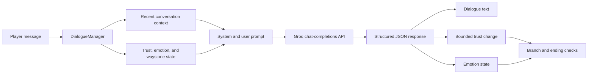

# The Warden of the Ashwood

A Unity 6 URP prototype that connects in-world NPC dialogue to an LLM-driven trust, emotion, and quest-state system.

Players speak with Eolindra, an ancient forest guardian. Each response is generated in character and returned as structured JSON containing dialogue, a bounded trust change, an emotion label, and a short internal reason. Local game logic then updates the conversation state and selects the next branch.

> **Repository status:** this branch consolidates the maintained v2 implementation into the clean-name repository. Repository-level validation passes, but the remaining Inspector wiring and a full Play Mode walkthrough still require the Unity Editor before a reproducible demo is claimed.

## Implemented systems

- Groq chat-completions integration using a configurable model
- Structured JSON response parsing with a local fallback response
- Short in-session conversation context limited to the latest eight lines
- Trust score bounded from 0 to 100
- Eight emotion states: hostile, angry, suspicious, sad, neutral, curious, warm, and grateful
- Trust momentum and consecutive-negative interaction tracking
- Attack/game-over path after repeated hostile interactions
- Three-waystone quest-state context and trust rewards
- First-person interaction, dialogue UI, NPC patrol/face-player behavior, a world-space emotion bubble, and ending UI

This is an LLM-assisted dialogue prototype. It does not implement an autonomous agent or durable cross-session memory.

## Architecture



## Technology

- Unity `6000.0.70f1`
- Universal Render Pipeline `17.0.4`
- C#
- Unity Input System
- Unity AI Navigation
- TextMesh Pro and Unity UI
- Groq-compatible chat-completions request flow
- Default model configured in code: `llama-3.3-70b-versatile`

## Project layout

Open the nested directory as the Unity project:

```text
AI Powered NPC Game/
  Assets/
    Scenes/MainScene.unity
    Scripts/NPC/
    Scripts/Player/
    Scripts/UI/
  Packages/
  ProjectSettings/
```

`AI Powered NPC Game/` is the single intended Unity project root. Duplicate root-level project settings from the v2 repository are intentionally not carried into this consolidated repository.

## Local setup

1. Install Unity `6000.0.70f1` through Unity Hub.
2. Open the nested `AI Powered NPC Game/` directory as the Unity project.
3. Confirm that `Assets/Scenes/MainScene.unity` is enabled in Build Settings; it is already recorded in the committed configuration.
4. Create a local `APIConfig` ScriptableObject through **Create → NPC → API Config**.
5. Supply your own local development key and ensure the generated credential asset remains ignored by Git.
6. Verify the remaining Inspector references described below before entering Play mode.

Never commit an API key. A key stored in a Unity client or downloadable build can be extracted. Use a protected backend proxy before distributing a build.

## Completed repository repairs

- `MainScene` is the active build scene.
- The serialized API credential was removed from the scene.
- The missing `FloatingEmotionIcon` script reference and its sprite fields were restored.
- `DialogueManager` is connected to the AI request handler and emotion icon in the scene.
- The serialized starting emotion matches the intended suspicious state.
- The positive ending requires both trust of at least 80 and all three waystones.
- Waystone progress is clamped, singleton setup is guarded, and ending/UI calls are null-safe.
- A GitHub Actions check validates the scene path, required script GUIDs, and absence of common committed key patterns.

## Remaining Unity Editor checks

- Assign and test `EndingManager.gameOverCanvas`; no confirmed game-over canvas exists in the serialized scene.
- Assign and test the three `activatePromptUI` references on the waystones.
- Run a complete Play Mode walkthrough covering dialogue, hostile/game-over behavior, all three waystones, and both endings.
- Revoke the previously exposed Groq credential and purge it from Git/LFS history; deleting it from the current tree does not invalidate the old key.
- Verify redistribution rights and attribution for third-party packages and the emotion-icon artwork.
- Add a custom screenshot or short capture only after the scene runs cleanly.

## Safety, privacy, and licensing notes

- LLM output is probabilistic and the current prototype does not include a full moderation or abuse-handling layer.
- Conversation context is held in memory for the current session only; there is no persistent player profile.
- The fallback keeps the interaction moving when the API fails, but it is not an offline dialogue system.
- The repository contains third-party asset packages. Confirm redistribution rights and add explicit credits before publishing a release or downloadable build.
- Repository-level continuous integration is provided; it is not a substitute for Unity compilation, Play Mode tests, a release build, or a downloadable demo.
